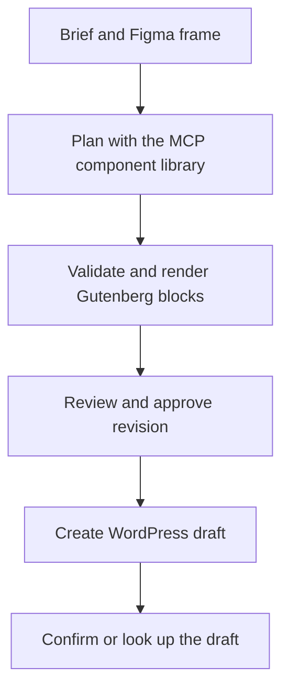

# Brief to WordPress

Turn an editorial brief and a Figma frame into editable Gutenberg blocks. Review the exact revision, approve it, then create a WordPress draft.

The local demo includes a sample Figma response and a sample draft store. It uses the real MCP connection to the component library and runs without API keys.

## Run the demo

Requires Python 3.11 or later.

~~~sh
python -m venv .venv
source .venv/bin/activate
python -m pip install -e .
python -m brief_to_wordpress
~~~

On Windows PowerShell, activate with `.venv\Scripts\Activate.ps1`.

Open [localhost:8000](http://localhost:8000). The form starts with an example brief.

1. Select **Generate review**. Check the preview, run history and **View Gutenberg blocks**.
2. Select **Approve revision**. Approval records the hash of the page, its generated blocks and destination.
3. Select **Simulate a lost delivery reply**, then **Create draft**. The local destination writes the draft and the workflow records an uncertain result.
4. Select **Check destination**. The workflow finds the saved draft by its unique slug and confirms the same record. Open the saved draft to inspect its content.

## How it works

- The Figma importer reads a frame and the notes on three named child sections. The planner uses the approved component library exposed by a read-only MCP server.
- In live mode, OpenAI requests the library through a function call and returns a structured page plan through a second function call. The application validates the plan and generates the WordPress blocks.
- SQLite stores the revision and event history. A transaction lets one delivery request claim the approved revision. A lost response leaves the delivery pending until a read-only lookup confirms the draft.
- Gutenberg headings, paragraphs, lists and buttons remain editable in WordPress. The destination request uses the draft status.

## Connect live services

The app runs locally. Set environment variables before starting it. Use an OpenAI model available to your account with Chat Completions function calling support.

~~~sh
export PIPELINE_MODE=live
export OPENAI_API_KEY=...
export OPENAI_MODEL=...
python -m brief_to_wordpress
~~~

The sample design and local draft store are still available in live mode.

| Integration | Configuration |
|---|---|
| Figma | Set `FIGMA_TOKEN`. In the console, enter the file key and frame node ID. The frame needs direct children named `@hero`, `@benefits` and `@cta` in that order. |
| WordPress | Set `WORDPRESS_URL` to the HTTPS base URL, plus `WORDPRESS_USERNAME` and `WORDPRESS_APP_PASSWORD`. Use an account permitted to create and read drafts on that site. |
| Storage | Set `PIPELINE_DB` to choose the SQLite file. The default is `.state/pipeline.sqlite3`. |

The app sends the brief and selected frame notes to OpenAI in live mode. Keep provider credentials in the environment. The console binds to loopback. A shared deployment would need authentication and access controls.

The component library also runs as a standalone stdio MCP server.

~~~sh
python -m brief_to_wordpress.catalog
~~~

## Checks

~~~sh
python -m unittest discover -s tests -v
~~~

The tests exercise the actual MCP stdio connection, revision approval, the delivery claim and recovery after a lost reply. The live provider paths use simulated HTTP responses in tests. A live service run requires your credentials and a destination site.
